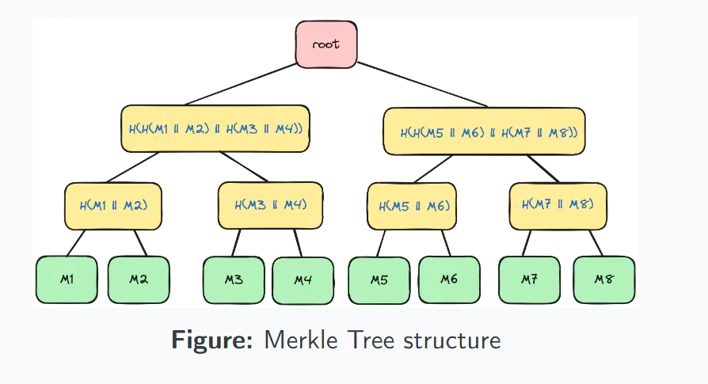
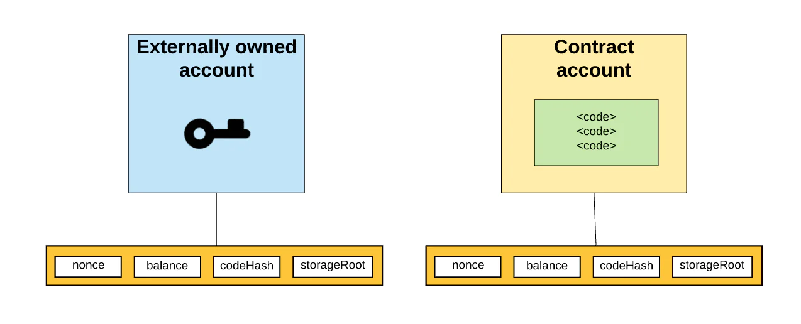
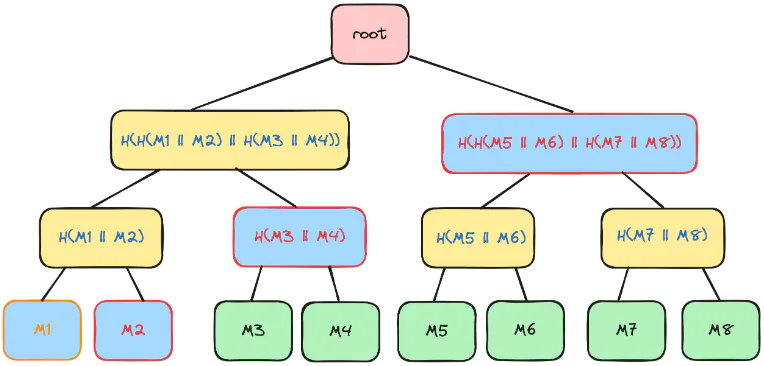
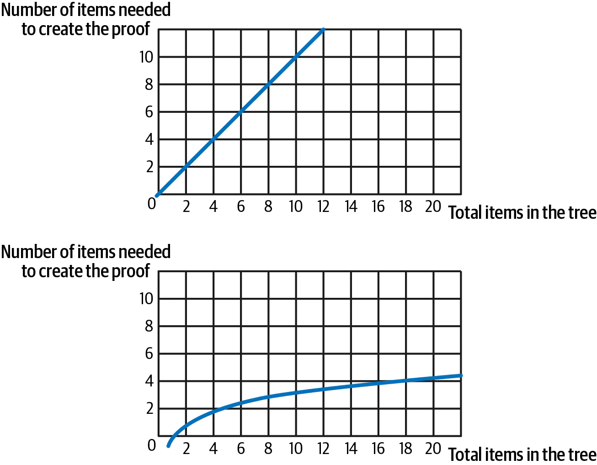

Understanding cryptographic commitment schemes, hiding vs preimage resistance, binding vs collision resistance, and Merkle tree vector commitments.

<!--more-->


- **Series**: Commitment Schemes (Part 1)
- **Topics**: Hash Commitments, Hiding & Binding, Merkle Trees
- **Exercises Repo**: [`koyphshii/commitment-schemes-lab`](https://github.com/koyphshii/commitment-schemes-lab)


## What Is a Commitment Scheme?

So a cryptographic commitment scheme is a scheme that allows a party we call the committer to commit to a certain statement without revealing the statement itself, the original statement gets revealed later completely or partially at the moment of disclosure. The committer is the one that reveals the original statement by opening the commitment by providing some additional information (the original statement and an opening hint), and the party that verifies that opening is valid is called the verifier.

To make things less verbose lets give some notations :

- the statement we want to commit to is $m$
- the commitment of $m$ is $c$
- the opening hint is $r$

For example we commit using a hash function $H$ :

$$\Large H(m \parallel r) = c$$

The commitment scheme follows 3 steps :

- **setup** : this generates public data $\text{pp}$ for both parties (committer and verifier), this data is for configuration for example what hash function should we use
- **commit** : we generate the commitment $c$ of the statement $m$ using $\text{pp}$ and randomness $r$
- **open** : here the verifier checks the opening of $c$ with $m$ and $r$ (the opening is the data the committer provides when he wants to disclose which is $m$ and $r$)

A commitment scheme should satisfy 2 properties :

1 - **hiding** : the verifier should not learn any additional information about the statement $m$ from its commitment $c$

2 - **binding** : after publishing $c$, the committer shouldn't be able to open that same commitment $c$ to a different statement $m_2 \neq m_1$

When it comes to hash-based commitments you might notice the hiding and binding properties look very similar to preimage resistance and collision resistance.

## Hiding vs Preimage Resistance

Preimage resistance means that given the hash digest $h = H(m_1)$, it should be computationally infeasible to find any $m'$ such that :

$$\Large H(m') = h$$

($m'$ could be different or equal to $m_1$). Basically the concept is that we shouldn't be able to reverse the hash function, that is what it guarantees. For example if the message we are hashing comes from a small set that is guessable, preimage resistance will not protect it.

Hiding is defined using a simple game (the hiding game) :

1 - the verifier (attacker) picks any two messages $m_0 \neq m_1$ and sends them to the committer

2 - the committer flips a secret coin $b \in \{0, 1\}$, picks fresh randomness $r$, and sends back $c = \text{Commit}(m_b, r)$

3 - the attacker looks at $c$ and outputs a guess $b' \in \{0, 1\}$

The scheme is hiding if no realistic attacker can guess right noticeably better than a blind coin flip ($\frac{1}{2}$). Notice two things here :

First, without randomness $r$, the attacker just computes $H(m_0)$, compares it with $c$, and wins with probability $1$. Adding a fresh random salt $r$ makes the commitment non-deterministic across multiple sessions.

Second, preimage resistance alone is still not enough for hiding. Imagine a hash function $H'(x) = \text{first\_bit}(x) \parallel \text{SHA256}(x)$. Even with a 256-bit salt $r$, $H'(m \parallel r)$ is still preimage-resistant (you still can't invert SHA256 to recover $m \parallel r$), yet it literally leaks the first bit of $m$, so the attacker picks $m_0$ starting with `0` and $m_1$ starting with `1` and wins the hiding game with probability $1$.

So to prove $c = H(m \parallel r)$ passes the hiding game, we need a stronger assumption on $H$, which is modeling $H$ as a Random Oracle (the Random Oracle Model, or ROM). In the ROM, we treat $H$ as an ideal hash that outputs fresh uniform random bits for every unseen input (leaking zero bits). Then if $r$ is $\lambda$ random bits (for example $256$) and the attacker makes $q$ calls to $H$, the only way they learn anything about $m_b$ is by guessing the exact $r$ and calling $H(m_b \parallel r)$, which happens with probability at most $\frac{q}{2^\lambda}$ :

$$\Large \Pr[b' = b] \le \frac{1}{2} + \frac{q}{2^\lambda}$$

> **NOTE** : this doesn't mathematically prove `SHA256` itself has zero hidden flaws (nobody can prove that directly on `SHA256`'s internal operations). What it proves is that our commitment construction $H(m \parallel r)$ has no structural bugs (for comparison, unsalted $H(m)$ still fails even in the ROM). In real code we plug in `SHA256` or `Keccak` and assume it behaves closely enough to a Random Oracle.

## Binding vs Collision Resistance

First lets explain binding simply, before we said for the disclosure to happen the committer opens the commitment by providing $(m, r)$, and the verifier verifies it, so we say opening the commitment succeeds when the verification is valid.

We want the opening to be valid only for the original statement $m$, meaning the committer can't find two valid openings $(m_1, r_1)$ and $(m_2, r_2)$ with $m_1 \neq m_2$ such that :

$$\Large H(m_1 \parallel r_1) = H(m_2 \parallel r_2)$$

That is what binding means. Notice that in the normal case if $m_2$ comes after committing to $m_1$, that sounds like second preimage resistance, but the prover (prover as in committer) could work on a colliding pair $(m_1, r_1)$ and $(m_2, r_2)$ before committing to anything, which puts it in the collision resistance class.

## Merkle Tree Commitments

Now imagine we have a piece of data, and instead of representing it as a single block $M$, it can be represented as a vector list of $n$ elements :

$$\Large M = \langle M_1, M_2, \dots, M_n \rangle$$

Using the previous commitment scheme, the naive approach would be that the prover commits to the whole vector $M$ with $C$ by doing :

$$\Large C = H(M_1 \parallel M_2 \parallel \dots \parallel M_n)$$

Notice the difference that happens this time :

1 - the verifier could ask for the proof of the whole message $M$, in that case sending the full vector $\langle M_1, \dots, M_n \rangle$ so the verifier can recompute $C$ is sufficient (we avoid talking about the opening hint and other parameters for simplicity). In this case there is nothing more efficient we could think about, the scheme is good.

2 - now the verifier instead of asking for the proof of the whole message $M$, he starts asking for proof of $M_1$, meaning proof that $M_1$ is an element of the vector list. In this case the prover still needs to provide him all $n$ elements of the vector list in order for the verifier to recompute $C$.

For the second case we can make it more efficient by storing the data like following :

Storing the data like this has one main reason which is that the cryptographic proof given by the prover (the data the committer publishes in opening) is much more efficient compared to the previous naive approach.

### Real-World Example : Ethereum World State

Before everything remember that having a snapshot for the whole data we are storing is always present, when working with the Merkle tree structure the snapshot is the Merkle root hash and in the classic approach the snapshot is the hash of the elements concatenated.

Now the example : we want to prove the inclusion of $M_1$. Taking this as a real example lets say the Ethereum world state is the data we are working with, the snapshot (the hash) of the current state is known from a trusted source which is the latest block metadata.

The Ethereum world state consists of a mapping between account addresses and account states, where each account state consists of four components :

$$\Large (\text{nonce},\ \text{balance},\ \text{codeHash},\ \text{storageRoot})$$

> **NOTE 1** : in this example the plain Merkle tree only focuses on binding, no hiding is present here (so formally it is a binding-only vector commitment). There is no issue with that depending on the use case, and if you want hiding you can salt each leaf as $H(M_i \parallel r_i)$ or build privacy layers on top of Ethereum, check Aztec Network.
>
> **NOTE 2** : Ethereum actually uses a Modified Merkle Patricia Trie (MPT), which is a 16-branch prefix trie so it can handle dynamic `address -> account` mappings and non-inclusion proofs. In the diagrams below we use a simpler binary Merkle tree to show the core idea.

In Ethereum there is around $200\text{ million}$ accounts, all these together form the world state. Now for a given address, we want to verify that the balance is correct.

For this example the tuple $(\text{nonce}, \text{balance}, \text{codeHash}, \text{storageRoot})$ represents one element of the vector list, remember that the only hash we trust is the snapshot we talked about before. So it should be used in the proof, and with the naive hash to recompute the snapshot we would need all the other accounts grouped together and then hashed.

But by using the tree structure we would need way fewer elements to reproduce the snapshot (the root).

There is a fixed pattern to follow :

In this case we are proving inclusion of $M_1$, so the prover only needs to send the 3 sibling hashes along the path to the root :

$$\Large \pi_1 = \big(M_2,\ H(M_3 \parallel M_4),\ H(H(M_5 \parallel M_6) \parallel H(M_7 \parallel M_8))\big)$$

> **NOTE 3** : in real implementations you should separate leaves from internal nodes (for example $H(\texttt{0x00} \parallel M_i)$ for leaves and $H(\texttt{0x01} \parallel L \parallel R)$ for internal nodes) so nobody can pass an internal node off as a leaf.

Speaking in mathematical terms, Merkle trees offer $O(\log n)$ proof size and verification time versus linear $O(n)$ of the naive approach (committing to the whole vector is still $O(n)$ for both, and for $200\text{ million}$ accounts that means $\log_2(2 \times 10^8) \approx 28$ hashes instead of $200\text{ million}$!).

---

Next up in this series : **Part 2 - Pedersen Commitments** and **Part 3 - KZG Polynomial Commitments**, along with practical exercises in [`commitment-schemes-lab`](https://github.com/koyphshii/commitment-schemes-lab).
