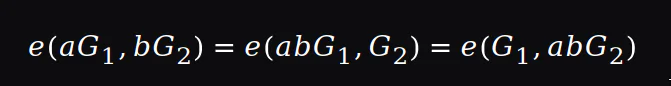
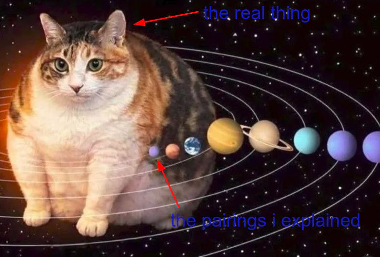
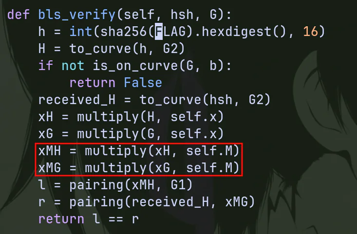
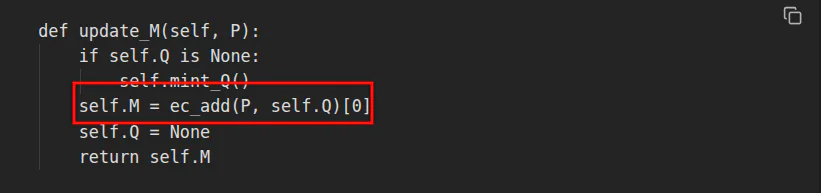
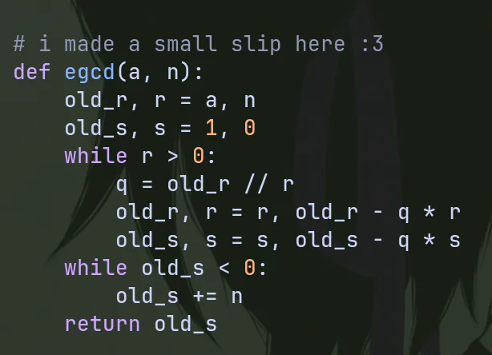
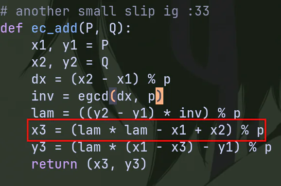

Writeup for the BBLS crypto challenge, exploiting a modified BLS signature scheme through bilinear pairings.

<!--more-->


- **Event**: Mini IngeHack
- **Challenge**: BBLS
- **Category**: Crypto


If you want to solve the challenge locally you will find the challenge full source and connection files in the event public repo [`mini-ingehack2026/challenges/crypto/bbls`](https://github.com/Ingeniums/mini-ingehack2026/tree/main/challenges/crypto/bbls)

This is my writeup for a CTF challenge I worked on in the previous Mini IngeHack online event that ran weeks ago, the goal from this writeup is to guide participants or people interested in the subjects presented in this challenge. So let's get started ! 

The players were given the challenge source file that was running on a tcp connection with the command to interact with it : `ncat --ssl --ssl-verify bbls.challs.ingeniums.club 9450`

The challenge gives us 3 options to use :

## Challenge Source

### 1 - `get_Q`

This generates a random point $Q = (x \bmod p,\ y \bmod p)$ where $p$ is the preset modulus :

```python
def mint_Q(self):
    self.Q = (
        int.from_bytes(os.urandom(32), "big") % p,
        int.from_bytes(os.urandom(32), "big") % p,
    )
    return self.Q
```

and then prints the generated $Q$

### 2 - `update_M`

```python
def update_M(self, P):
    if self.Q is None:
        self.mint_Q()
    self.M = ec_add(P, self.Q)[0]
    self.Q = None
    return self.M
```

Here the coordinates of $P$ are set by the player where no condition is set on the values.

At the end the value of `self.M` is updated.

### 3 - `check`

Here a BLS verification is done :

```python
def bls_verify(self, hsh, G):
    h = int(sha256(FLAG).hexdigest(), 16)
    H = to_curve(h, G2)
    if not is_on_curve(G, b):
        return False
    received_H = to_curve(hsh, G2)
    xH = multiply(H, self.x)
    xG = multiply(G, self.x)
    xMH = multiply(xH, self.M)
    xMG = multiply(xG, self.M)
    l = pairing(xMH, G1)
    r = pairing(received_H, xMG)
    return l == r
```

This implementation is different than the standard one, **OH YES**

This challenge is intended to be a basic one about BLS signatures which are based on bilinear pairings so I will take the chance to give a brief explanation about these pairings.

> **Note 1** : in case you already know about them you can skip this part
>
> **Note 2** : I am a beginner in this field, so don't take it as an official resource to work on, instead my goal is to have people review it and help me improve on tagging mistakes I did

---

## Explaining Bilinear Pairings

> Before we start, I made a [YouTube video](https://www.youtube.com/watch?v=8IoWof4ZbFI) that explains group theory and elliptic curves in a beginner friendly way, so if you are not familiar with them and want to learn about pairings, it is a nice place to start.

### 1 - What a bilinear function is

In its simplest form, a bilinear function is a function that takes 2 arguments where if you fix one and the other varies, the output will vary with that input that is not fixed.

So it is a function $f : A \times B \to C$ where $f(a,b) = c$, if we fix $a$

$b$ and $c$ will vary in the same way (meaning they scale together, if we multiply $b$ by 2, $c$ will scale by 2 also, and so on)

For example $f(x,y) = 5xy$, if we fix $x$ or $y$, lets say we set $y = 2$, it will become a linear function $f(x) = 10x$

I know this may sound stupid, but lets talk about linear functions :

A linear function is a function where the input and output behave in the same way when working with either addition or multiplication, so it preserves the structure of these 2 operations, and that is why we always define a linear function with 2 properties :

1 - $f(x+y) = f(x) + f(y)$

2 - $f(k \cdot x) = k \cdot f(x)$

And from these, we can conclude that bilinear functions also have these 2 properties.

### 2 - Bilinear functions in the context of cryptography

Here the headaches may start, but hopefully it is simple if we look at it from a good angle.

We talked about bilinear functions before, right? Cool. Now when we take the same exact function and write $f : G_1 \times G_2 \to G_t$ where :

* $G_1, G_2$ are 2 elliptic curve groups (they can be same or different but same order)
* $G_t$ is not an elliptic curve group, probably all you need to know about is that it is a finite cyclic group, but I will add some details later

We can absolutely do that because we didn't restrict what group elements the function $f$ takes.

Now with this $f$ function that works with elliptic curves, our goal is to achieve :

For $P = p \cdot G$ and $Q = q \cdot G$ and $R = r \cdot G$, we prove that we know $p \cdot q = r$ without ever leaking their values, only by using the public points $P, Q, R$.

And there is a bilinear mapping that allows us to do that :

$$\Large f(P, Q) = f(R, G)$$

And we call it a **bilinear pairing**.

> **NOTE** : we use the word "pairing" in the context of elliptic curves only

So a bilinear pairing is a function that corresponds to the product of the discrete logs of the arguments, which are the points.

Now where did this come from ?

Lets talk a bit more about $G_t$ :

$G_t$ is a subgroup of the multiplicative group of a finite field extension.

As we know a finite field $\mathbb{F}_p$ is composed from 2 groups, one under addition and the other under multiplication excluding 0, an extension of the field can be $\mathbb{F}\_{p^{12}}$, so we work with elements of dimension 12 instead of 1 dimension elements following some rules.

And the multiplicative group of the field is simply the group that is working with multiplication.

And by subgroup we simply take less elements of the whole group, but a subgroup is still considered a group by itself.

So $G_t$ works with elements under multiplication, Cool!

Now if we take this pairing : $f(k \cdot A, B)$, what we can do with it ?

Remember that the pairing is a linear function when we fix one argument !

So if we fix $B = H_1$ we get $f(k \cdot A, H_1)$ and this is a linear function, and using the addition property we get :

$$\Large f(k \cdot A, H_1) = f(A, H_1) \cdot f(A, H_1) \cdots k \text{ times} = f(A, H_1)^k$$

Now we do the same thing for $B = H_2$ and $B = H_3$ and so on, we notice that it is true for every point we set $B$ to, so we can directly say :

$$\Large f(k \cdot A, B) = f(A, B)^k$$

From this, all properties are easier to understand.

For example we can say :



because they can all be written : $e(G_1, G_2)^{a \cdot b}$

Why is $G_t$ really complex? Well remember that the pairing is a function, it takes inputs and gives output, we need it to satisfy the properties of a linear function, so $G_t$ is probably the group that satisfies it. Well this explanation is so abstract, I am trying to get better with the theory, in case you are interested to know from where I am reading. There is this book called **zkdl** you can find it online for free from here : [zkdl-camp.github.io](https://zkdl-camp.github.io)

Trust me what I gave was just basics, check the book to confirm.



---

## Solving The Challenge

Now we have a basic idea about bilinear pairings, we can solve the challenge easily :

Inside the BLS verification the thing that was added was these 2 lines :



Notice that without these 2 lines being added the equation we would have to forge was :

$$\Large e(x \cdot H, G_1) \equiv e(H', x \cdot G)$$

which is equivalent to :

$$\Large e(H, G_1)^x \equiv e(H', G)^x$$

That is impossible because we don't know $H$ and we can't control $x$ (for example making it equal to 0).

Now with the lines added it becomes :

$$\Large e(H, G_1)^{x \cdot m} \equiv e(H', G)^{x \cdot m}$$

If $m$ is zero, the challenge is solved :>>>

Remember this block :



(here the x coordinate of the `ec_add` is assigned to the new `M`)

Checking the egcd that was used inside the elliptic curve addition :



The comment was a hint to spot that in case $a = 0$ it returns 0.

That is a mistake because the inverse of 0 shouldn't be 0.

This means if $x_2$ and $x_1$ are equal $\lambda$ will be 0.

Inside `ec_add` :



$$\Large x_3 = (\lambda^2 - x_1 + x_2) \bmod p$$

The correct elliptic curve addition subtracts $x_2$, but here we added it up.

This confirms that the intended solution is for the player to provide equal $x_2$ and $x_1$ to force $x_3$ into 0 (which means $M$ is 0).

This challenge was kind of guided for the participants to end up in one solution. There are so many other solutions besides this, see you in part 2 ! 

In case you are interested to learn about BLS signatures check this out : [The Versatility of BLS Signatures](https://www.zellic.io/blog/bls-signature-versatility), they have a great pairings explanation too if you don't like very formal math (i am referring to the book zkdl), you can find it inside
