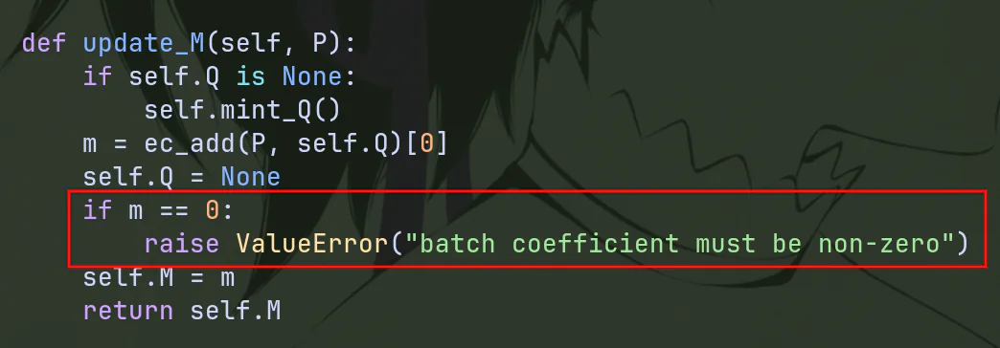
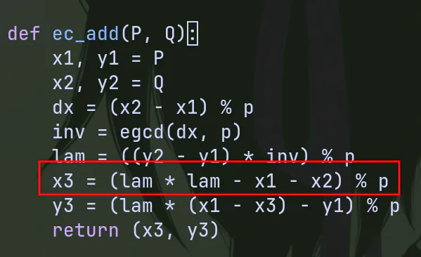
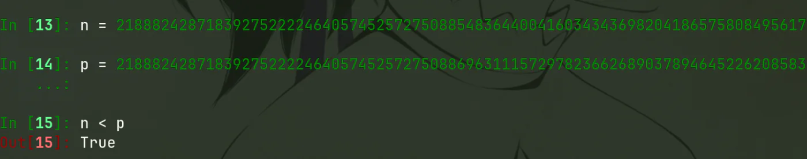
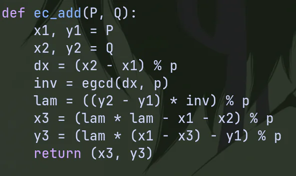

a challenge i made about bls signatures part2

<!--more-->


- **Event**: Mini IngeHack
- **Challenge**: BBLSv2
- **Category**: Crypto


This challenge comes as a harder (revenge) version for the previous [BBLS](/posts/bbls/) challenge.

## What Changed

The source for this challenge is similar to the previous one besides there were a few changes :

Here the returned $m$ is restricted from being equal to $0$, making the old trick unfeasible.

And the elliptic curve addition was fixed :

## The Vulnerability

One thing worth noticing is that the value of $m$ getting used in the pairing is reduced modulo python's library `py_ecc.optimized_bn128` elliptic curve order, which is equal to :

`n = 21888242871839275222246405745257275088548364400416034343698204186575808495617`

Before that inside `update_M`, we work modulo the curve prime :

`p = 21888242871839275222246405745257275088696311157297823662689037894645226208583`

You might have guessed it, but this is a common mistake that could happen during implementations, which is confusing the curve finite field prime $p$ with the elliptic curve group order $n$.

The finite field modulus $p$ should only be used for the point coordinates computations like computing $x_3$. In our implementation actually there is no mistake for this part, the problem is that this $x_3$ is later used in the pairing, and the pairing by default uses the order of the elliptic curve group $n$ as modulus.

Now lets simply formalize what all this talking means :

1 - first you compute $m$ in $\mathbb{F}_p$

2 - later you use this $m$ as an element in $\mathbb{Z}_n$, where $n$ is the order of the elliptic curve group

This means the first $m$ is computed as $m \bmod p$, and then the new $m$ (lets call it $m'$) is computed modulo $n$ :

$$\Large m' = (m \bmod p) \bmod n$$

This final value is the one used in the pairing.

## Solving The Challenge

$n$ is smaller than $p$ ($n < p$) :

So if the output of `update_M` is equal to $n$, the value used in the pairing becomes :

$$\Large m' = n \bmod n = 0$$

which solves the challenge.

Forcing $x_3$ to be equal to $n$ is quite easy :

$$\Large x_3 = (\lambda^2 - x_1 - x_2) \bmod p$$

For example we can force $\lambda = 0$ by picking $y_1 = y_2$, and then picking $x_1 = (-x_2 - n) \bmod p$ forces $x_3 = (-x_1 - x_2) \bmod p = n$.
