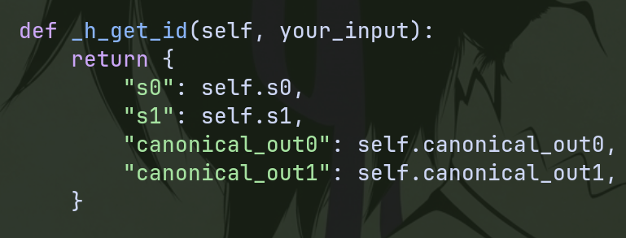
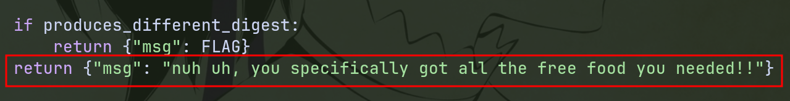

Writeup for the Zeus crypto challenge, exploiting an underconstrained modular reduction in a custom R1CS hash circuit.

<!--more-->


- **Event**: Mini IngeHack
- **Challenge**: Zeus
- **Category**: Crypto


This challenge was about a custom hash function I made that is very similar to Poseidon, the sponge-based cryptographic hash function everyone knows.

Before reading the writeup I expect you to have an idea about Poseidon and how it works, check this for a simple explanation : [Poseidon Hash](https://docs.orochi.network/research/poseidon-hash/)

## Explaining The Challenge

The participants were given a minimal R1CS circuit for Zeus (the custom hash function), this circuit takes as input the original message and its hash digest and checks it via 6 constraints :

$$\Large
\begin{gathered}
(s_0 + rc_0) \cdot (s_0 + rc_0) = D_0 \\\\
D_0 \cdot 1 = A \cdot Q_0 + C_0 \\\\[6pt]
(s_1 + rc_1) \cdot (s_1 + rc_1) = D_1 \\\\
D_1 \cdot 1 = A \cdot Q_1 + C_1 \\\\[6pt]
(2 \cdot C_0 + C_1) \cdot 1 = \text{out}_0 \\\\
(C_0 + 3 \cdot C_1) \cdot 1 = \text{out}_1
\end{gathered}
$$

Walking through the constraints we explain the circuit :

$s_0$ and $s_1$ : these 2 signals are the original message split into 2 states (similar to Poseidon but lesser number of states)

$D_0 \cdot 1 = A \cdot Q_0 + C_0$ : this is the interesting part because if you notice this is equivalent to saying that $C_0 = D_0 \bmod A$

Later in $(2 \cdot C_0 + C_1) \cdot 1 = \text{out}_0$ we use $C_0$ for the final check.

## Some Modulus Tweaking

Now lets explain the reason behind that modulus reduction :

Numbers in R1CS are defined under a modulus, the modulus getting used depends entirely on what proving system we use the constraint system with, that proving system generally relies on a specific elliptic curve, so the modulus used is that curve order.

For example Groth16, which is the most deployed SNARK implementation, uses BN254 (`alt_bn128`).

Later in this writeup when we learn what to do with this circuit you will find out that this curve order is the one that was used in this circuit.

Poseidon operations by default are defined under BN254 (`alt_bn128`) order making its construction compatible with Groth16 circuits.

But our case is different, Zeus's idea was about using a bigger modulus than what BN254 (`alt_bn128`) order is for better security, which means we should do the modulus reduction manually inside the circuit.

> **NOTE** : the circuit's default modulus BN254 (`alt_bn128`) is always forced for each signal, but we can define bigger numbers (aka numbers with a bigger field) by splitting that number into 2 signals or more.

You might have noticed that the modulus is actually smaller which contradicts what I was saying, and even has a lesser number of rounds and states, so our Zeus in this case doesn't have anything to offer over Poseidon. Like actually nothing.

Well there is a valid reason for me doing that, if I made it real like Poseidon the circuit would have grown very very big, which could make it non suitable for a CTF.

## Solving The Challenge

The service that gives us the flag is `chall.py`, this is the script that the players should interact with.

This python server simply works by taking our witness and verifies it by this function :

`verify_circuit(self, Q0, C0, Q1, C1, out0, out1)`

First to not get confused, by verification here I mean the server takes the witness and runs the same exact constraints that we represented before, there is no proof generated in this challenge.

By reading the file you will notice that the player is restricted with a fixed $(s_0, s_1)$ and their hash digest is registered :

The participant can for sure generate a valid hash for this given instance, the problem is :

The server is sort of blacklisting that specific hash digest.

The reason behind this design is to make this challenge a kind of game where the player has a fixed id $(s_0, s_1)$ and did claim his reward before, but now he can't claim it again and should find a way to break this system.

So the player's goal here is to find a way to generate a different hash digest for the same $(s_0, s_1)$ (since he can't edit them and the server is hardcoding them inside the circuit execution) while making all the constraints valid. If the circuit was 100% designed correctly there is no way this could happen, but this challenge circuit is actually underconstrained.

## Finding The Bug

Returning to the circuit constraints :

$$\Large
\begin{gathered}
(s_0 + rc_0) \cdot (s_0 + rc_0) = D_0 \\\\
D_0 \cdot 1 = A \cdot Q_0 + C_0 \\\\[6pt]
(s_1 + rc_1) \cdot (s_1 + rc_1) = D_1 \\\\
D_1 \cdot 1 = A \cdot Q_1 + C_1 \\\\[6pt]
(2 \cdot C_0 + C_1) \cdot 1 = \text{out}_0 \\\\
(C_0 + 3 \cdot C_1) \cdot 1 = \text{out}_1
\end{gathered}
$$

Remember how we are doing the reduction :

$$\Large D_0 \cdot 1 = A \cdot Q_0 + C_0$$

and

$$\Large D_1 \cdot 1 = A \cdot Q_1 + C_1$$

Do you think this alone is enough ?

Lets say for a given $(Q_0, C_0)$ where $C_0$ is genuinely $D_0 \bmod A$, by replacing $Q_0$ by $Q_0 - 1$ and $C_0$ by $C_0 + A$, the equation will still remain balanced :

$$\Large A \cdot (Q_0 - 1) + (C_0 + A) = A \cdot Q_0 + C_0 = D_0$$

even though $C_0 + A$ isn't the remainder and is actually bigger than $A$ !!

That is exactly the bug, we should have added another constraint that checks if $C_0 < A$.

With that being said, the player can forge a valid witness for $(s_0, s_1)$ while producing a different hash digest, solving the challenge!!
